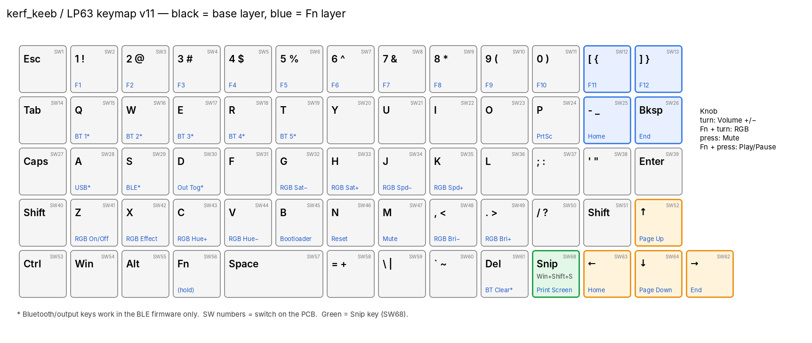

<p align="center">
  
</p>

<h1 align="center">kerf_keeb</h1>

<p align="center">
  <b>A 65-key, low-profile, wireless mechanical keyboard with a rotary knob, a nice!view display and its own 2.4 GHz USB-C dongle.</b><br>
  Open hardware by <a href="https://github.com/redwan2003-bot">Redwan Ahmmed</a> · brand: <b>Kerf</b> · firmware: <a href="https://zmk.dev">ZMK</a>
</p>

<p align="center">
  
  
  
  
  
</p>

---

## What is it?

kerf_keeb (internal name **ByranTK LP63**) is a compact keyboard I designed from scratch: schematic, PCB, firmware, switch plate and knob. It uses **Gateron KS-33 low-profile switches** on hot-swap sockets in a **column-aligned 13 × 5 grid**, so every key is 1U except a 2U space.

It works in three ways:

1. **Bluetooth**, straight to a PC, phone or tablet (up to 5 devices).
2. **USB cable**.
3. **The kerf dongle**: a tiny custom USB-C receiver (nRF52833). With the ESB firmware the dongle link is about **1–2 ms** from keypress to PC.



## Features

| | |
|---|---|
| **Keys** | 65 hot-swap keys (Gateron KS-33 / Low Profile 2.0), 19.05 mm pitch, 13 × 5 grid with a 2U space and a dedicated arrow cluster |
| **Snip key** | One key for Win + Shift + S (screenshot); Fn + Snip = Print Screen |
| **Knob** | Alps EC12 encoder. Turn = volume, Fn + turn = underglow brightness, press = mute, Fn + press = play/pause |
| **Display** | nice!view (Sharp memory LCD): battery, connection and layer. The ESB build adds link quality (RSSI, channel, retries) |
| **Lighting** | 8 × WS2812B underglow, with a MOSFET switch that cuts their power when off |
| **Wireless** | BLE 5 to up to 5 hosts, or the kerf dongle (BLE or Nordic ESB 2.4 GHz) |
| **Controller** | nice!nano v2 or a compatible "Pro Micro nRF52840", plus a 74HC595 row driver |
| **Power** | 1-cell LiPo on a JST-PH connector, hard power switch, reset button, USB-C charging through the controller |
| **Dongle** | nRF52833, 18 × 39.4 mm 4-layer PCB, direct USB-C plug, PCB antenna, RGB status LED |
| **Plate** | 3D-printable (FDM), designed for a Bambu Lab A1, with a fit-test coupon |

## Repository layout

```
kerf_keeb/
├── README.md                ← you are here
├── hardware/
│   ├── README.md            ← PCB details, pin map, power design, verification
│   ├── keyboard/            ← JLCPCB BOM + CPL (pick-and-place) for the keyboard PCB
│   ├── dongle/              ← JLCPCB BOM + CPL for the nRF52833 dongle
│   └── artwork/             ← Kerf / kerf_keeb logo SVGs used on the silkscreen
├── firmware/
│   ├── README.md            ← which file to flash, and how
│   ├── zmk-config-ble/      ← ZMK v0.3 config: Bluetooth + USB + BLE dongle
│   ├── zmk-config-esb/      ← ZMK main + split-esb: ultra-low-latency 2.4 GHz dongle link
│   └── prebuilt/            ← ready-to-flash .uf2 files and the dongle bootloader
├── mechanical/
│   ├── README.md            ← printing notes
│   ├── plate/               ← switch plate (STEP/STL), fit coupon, CadQuery source
│   ├── knob/                ← EC12 knob (STEP/STL), CadQuery source
│   └── reference/           ← KS-33 switch + hot-swap socket model
└── docs/
    ├── ORDERING.md          ← how to order the PCBs from JLCPCB
    ├── PRODUCTION_READINESS.md ← audit results and what's left before fabrication
    ├── images/
    └── software/            ← plan for "Kerf Hub", a future configurator app
```

## Hardware at a glance

| | Keyboard PCB | Dongle PCB |
|---|---|---|
| Size | 272.8 × 97.3 mm | 18.0 × 39.4 mm |
| Layers | 2 | 4 (JLC04161H-7628 stack-up) |
| MCU | nice!nano v2 / Pro Micro nRF52840 (socketed module) | nRF52833-QDAA (on board) |
| Assembly | JLC assembles 95 bottom-side SMD parts; you hand-solder sockets, controller, display and encoder | JLC assembles 31 top-side parts |
| Checks | DRC 0, schematic DRC 0 errors / 0 warnings, schematic ⇄ PCB nets identical | the same |

Full details are in [hardware/README.md](hardware/README.md).

## Firmware at a glance

| Build | Link to the PC | When to use it |
|---|---|---|
| **BLE** (`firmware/zmk-config-ble`, ZMK v0.3) | Bluetooth, USB, or the dongle over BLE | Everyday use, phones and tablets, multiple hosts |
| **ESB** (`firmware/zmk-config-esb`, ZMK main + [damex/zmk-feature-split-esb](https://github.com/damex/zmk-feature-split-esb)) | Dongle only, Nordic ESB at 1 Mbps with auto-retries | Gaming: about 1–2 ms keypress → PC |

The ready-made files are in [firmware/prebuilt](firmware/prebuilt). To flash, double-tap reset (or press Fn + B) and drag the `.uf2` onto the drive that appears. See [firmware/README.md](firmware/README.md) for the exact order.

### Fn layer (hold Fn)

| Keys | Action |
|---|---|
| 1 … 0, [, ] | F1 … F12 |
| Q W E R T | Bluetooth host 1–5 (BLE build) |
| A / S / D | Output: USB / Bluetooth / toggle (BLE build) |
| Z X C V | Underglow on/off, next effect, hue +, hue − |
| G / H, J / K, , / . | Saturation − / +, effect speed − / +, brightness − / + |
| B / N | Bootloader / reset |
| M | Mute |
| P, - , Bksp | Print Screen, Home, End |
| ↑ ← ↓ → | Page Up, Home, Page Down, End |
| Del | Clear the current Bluetooth pairing |
| Snip | Print Screen |

## Status

> **Pre-production.** The PCBs are designed and audited but **not yet fabricated**, and the firmware **compiles for all 7 targets** but has **not yet run on real hardware**. Treat it as a reference design until the first boards are built and tested.

- [x] Schematic and PCB for the keyboard and dongle, DRC-clean, schematic ⇄ PCB verified
- [x] JLCPCB BOM/CPL files checked (all parts exist, designators match the PCB)
- [x] BLE and ESB firmware, dongle status LED, encoder push
- [x] Printable switch plate with fit coupon, and an EC12 knob
- [ ] Final Gerber export and the EasyEDA project published on OSHWLab
- [ ] First 5 boards built and tested (keys, power, radio range, sleep current)
- [ ] 3D-printed case and keycaps ([plan](docs/PRODUCTION_READINESS.md#whats-next))
- [ ] Kerf Hub configurator app ([plan](docs/software/KERF_HUB_SOFTWARE_PLAN.md))

## Build your own

1. Order the PCBs: follow [docs/ORDERING.md](docs/ORDERING.md).
2. Hand-solder the 65 KS-33 hot-swap sockets, the controller, the nice!view header and the EC12 encoder.
3. Print the plate fit coupon first, then the plate: see [mechanical/README.md](mechanical/README.md).
4. Flash the firmware: see [firmware/README.md](firmware/README.md).
5. Check the battery polarity at J2 against your cell before plugging it in. JST-PH LiPo leads are not standardised.

## Credits

- [ZMK firmware](https://zmk.dev) and the ZMK Shield Wizard
- [damex/zmk-feature-split-esb](https://github.com/damex/zmk-feature-split-esb), the ESB split transport
- [nice!nano and nice!view](https://nicekeyboards.com) by Nice Keyboards
- [Adafruit nRF52 bootloader](https://github.com/adafruit/Adafruit_nRF52_Bootloader), used on the dongle
- PCB designed in [EasyEDA Pro](https://pro.easyeda.com) and manufactured by JLCPCB

## License

[MIT](LICENSE) © 2026 Redwan Ahmmed. Hardware files, firmware and documentation are all covered.
