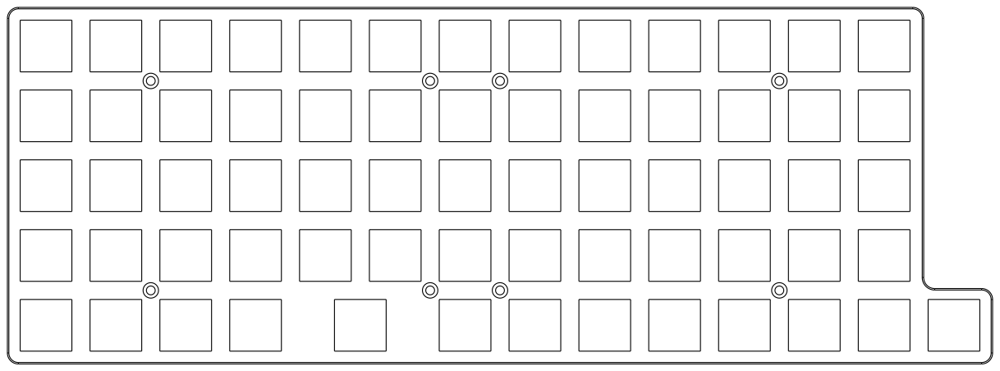
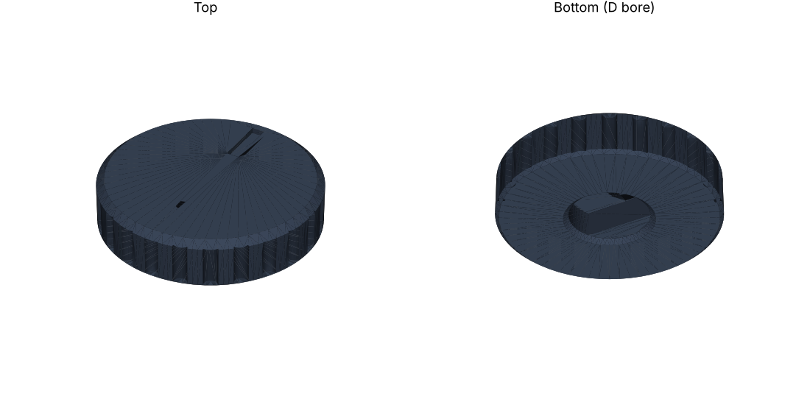

# kerf_keeb mechanical parts

All parts are parametric CadQuery scripts with STEP/STL exports. Coordinates come straight from the PCB (EasyEDA mil → mm).

## Switch plate (`plate/`)

| | |
|---|---|
| Size | 268.74 × 97.29 mm |
| Thickness | 2.0 mm total, 1.2 mm clip rim around each cut-out (16 mm pocket underneath) |
| Cut-outs | 65 × 14.1 mm (14.0 nominal + FDM allowance) |
| Holes | 8 × M2 countersunk, matching the PCB |
| Details | The plate stops before the controller column |

**Print the fit coupon first** (`lp63_plate_fit_coupon.stl`, a 3 × 3 key block). If KS-33 switches are loose or too tight, change `CUT` in `lp63_plate_cadquery.py` and re-export.

**Bambu Lab A1 note:** the plate is 268.7 mm long and the A1 bed is 256 mm, so the plate has to be split in two. A split version with a lap joint is planned along with the case.

Suggested settings: PLA or PETG, 0.4 mm nozzle, 0.16 mm layers, 4 walls, 100 % infill near the clips.

## Knob (`knob/`)

A knurled knob for the Alps EC12 D-shaft. Print upright at 0.12 mm layers, and check the shaft fit before printing several.

## Reference model (`reference/`)

`ks33_with_hotswap_socket.step`: a Gateron KS-33 switch with its hot-swap socket, used to check clearances against the plate and case.
